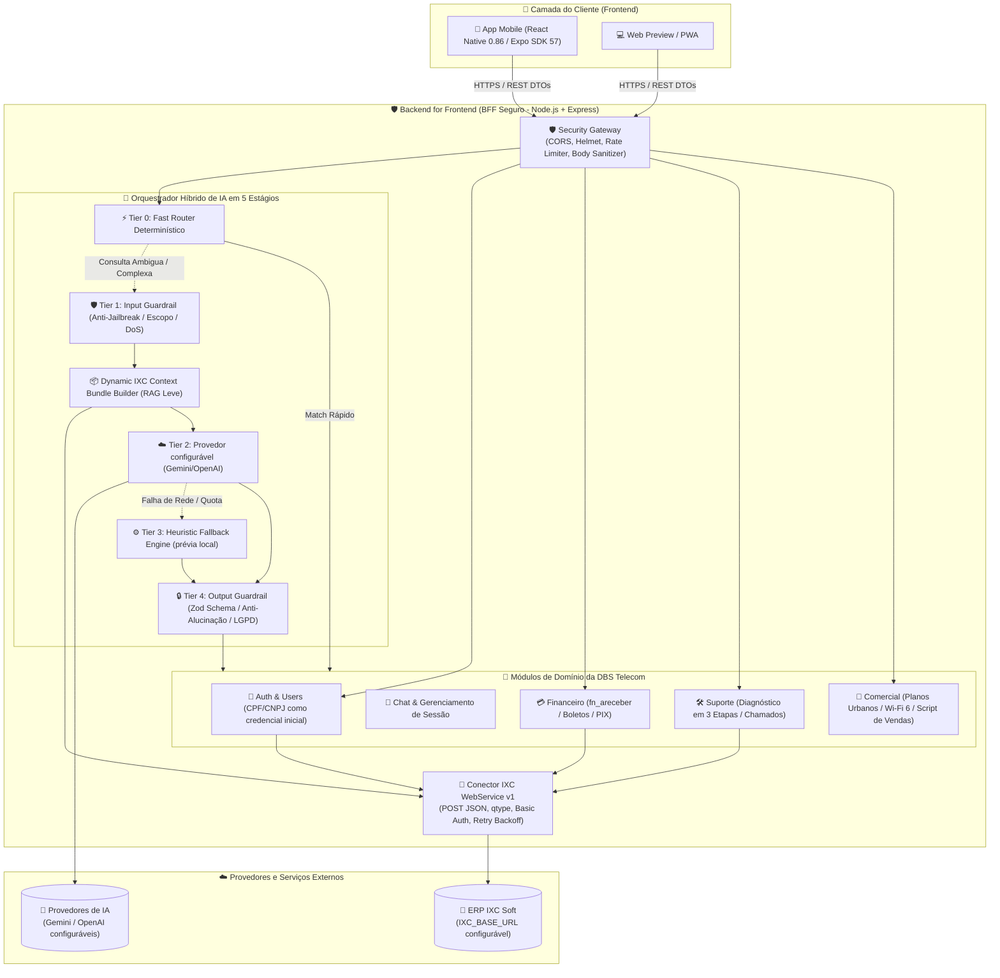
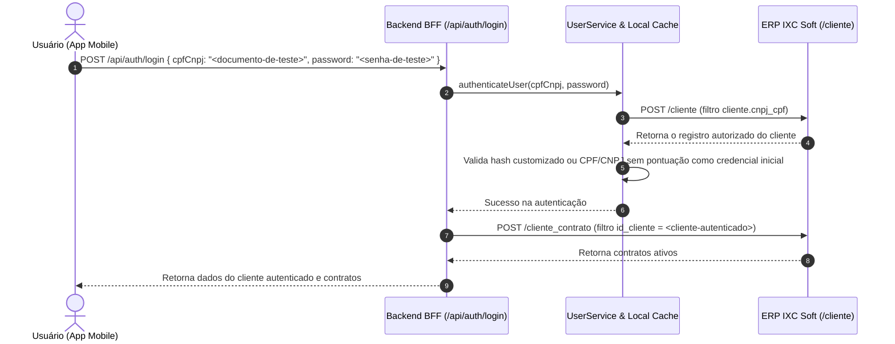
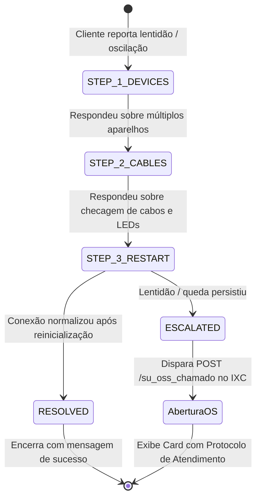

# 🏗️ Arquitetura do Sistema — DBS Telecom Mobile & Backend BFF

Este documento detalha a arquitetura técnica, os padrões de projeto, as decisões estruturais, o fluxo de dados e os princípios de segurança adotados no ecossistema do **Aplicativo Mobile e Backend de Atendimento Inteligente da DBS Telecom** integrado ao ERP **IXC Soft**.

---

## 1. Visão Geral da Arquitetura

O sistema adota o padrão **BFF (Backend for Frontend)** combinado com uma arquitetura modular em camadas orientada a domínio (Domain-Driven Modules). O aplicativo móvel atua exclusivamente como cliente de apresentação e interação do usuário, enquanto o Backend centraliza a segurança, a orquestração do motor de Inteligência Artificial, as regras de negócio de telecomunicações e a comunicação segura com o ERP IXC Soft.



---

## 2. Princípios e Decisões de Arquitetura

### 2.1 Padrão Backend for Frontend (BFF)
O aplicativo mobile nunca se comunica diretamente com a API do IXC Soft ou com os provedores de IA. O BFF desempenha os seguintes papéis críticos:
1. **Isolamento Total de Credenciais:** As chaves de API (`GEMINI_API_KEY`, `IXC_TOKEN`) nunca são compiladas no bundle mobile nem trafegam para o dispositivo do usuário.
2. **Adaptação e Enriquecimento de Dados:** A API do IXC Soft utiliza estruturas legadas em formato POST com filtros de tabela SQL (`qtype`). O BFF converte essas estruturas complexas em contratos REST limpos e tipados em TypeScript.
3. **Redução de Payload e Latência:** O BFF consolida múltiplas chamadas ao IXC (cliente + contratos + faturas pendentes) em um único bundle enriquecido.

---

### 2.2 Esteira de IA em cinco estágios (Fast Router + Guardrails)

Para buscar **baixa latência em rotas diretas**, **precisão semântica**, **custo otimizado** e uma degradação explícita quando provedores falham, o backend emprega uma arquitetura de IA em camadas:

```mermaid
flowchart TD
    Start([Mensagem do Usuário]) --> Clean[Normalização de Entrada: NFKC + Remoção de Homóglifos]
    Clean --> T0{Tier 0: Fast Router\nCorresponde a padrão direto?}
    
    T0 -- Sim (Boleto, Planos, 3 Etapas, etc.) --> FastRes[Resposta determinística\nClassificação com alta confiança]
    T0 -- Não / Ambiguidade --> T1{Tier 1: Input Guardrail\nPassou no Anti-Jailbreak e Escopo?}
    
    T1 -- Bloqueado (Jailbreak / Fora de Escopo) --> BlockRes[Resposta Segura Institucional DBS\nLog de Auditoria de Segurança]
    T1 -- Aprovado --> Context[Compilação do IXC Context Bundle\n(Cliente + Contratos + Faturas + Catálogo)]
    
    Context --> T2{Tier 2: Provedor configurado\nChave disponível e serviço online?}
    T2 -- Sucesso --> T4{Tier 4: Output Guardrail\nValidação Zod + Anti-Alucinação}
    T2 -- Erro / Sem Chave / Quota --> T3[Tier 3: Heuristic Fallback Engine\nMotor Determinístico Baseado em Regras]
    
    T3 --> T4
    T4 --> Sanitize[Sanitização LGPD e Mascaramento de Tokens]
    Sanitize --> Dispatch[Encaminhamento ao Módulo de Negócio e Entrega ao Mobile]
```

#### Detalhamento dos Tiers:
* **Tier 0 — Fast Router Determinístico:**
  - Analisa mensagens utilizando normalização, padrões e árvores de decisão léxicas.
  - Atende intenções imediatas (ex: boleto, lentidão, quantidade de aparelhos e objeções comerciais), poupando requisições ao LLM.
* **Tier 1 — Input Guardrail & Defesa em Profundidade:**
  - Intercepta tentativas de Prompt Injection, Jailbreak (ex: DAN mode, *"ignore previous instructions"*), pedidos de extração do System Prompt e perguntas fora de escopo (culinária, política, código).
  - Limita a entrada a 1.500 caracteres para evitar ataques de estouro de contexto e negação de serviço (DoS).
* **Tier 2 — Provedor de IA com RAG Dinâmico:**
  - O modelo e o provedor são configurados por ambiente (o Worker não deve assumir um nome de modelo obsoleto no código ou na documentação).
  - Recebe o System Prompt institucional enriquecido pelo `IXCContextBuilder` com os dados reais do cliente no IXC.
  - Saída forçada no formato JSON com `responseMimeType: "application/json"`.
* **Tier 3 — Heuristic Fallback Engine:**
  - Entra em operação automática e transparente caso o provedor configurado não esteja disponível ou ocorra timeout de rede.
  - Pode manter uma prévia local em ambiente offline, sempre marcada como demonstração e sem confirmar ações financeiras, contratos ou chamados.
* **Tier 4 — Output Guardrail & Conformidade LGPD:**
  - Valida a estrutura JSON com **Zod Schema**.
  - Impede alucinações financeiras (se a base IXC não tem faturas abertas, a IA é proibida de gerar boletos fictícios).
  - Varre e remove preventivamente qualquer token, segredo ou dado sensível que possa ter sido exposto.

---

### 2.3 Dynamic Context Bundle (`IXCContextBuilder`)

O `IXCContextBuilder` atua como um mecanismo leve de **RAG (Retrieval-Augmented Generation)** em tempo real. A cada mensagem que exige processamento do LLM, o builder compila:

```typescript
export interface IXCContextBundle {
  client?: {
    id: string;
    name: string;
    firstName: string;
    cpfCnpjMasked: string;
    address: string;
    city: string;
    neighborhood: string;
    phone: string;
    active: boolean;
  };
  contracts: Array<{ id: string; status: string; planName?: string }>;
  financial: {
    hasOpenInvoices: boolean;
    openInvoicesCount: number;
    nearestDueDate?: string;
    totalDueFormatted?: string;
    invoices: Array<{ id: string; valor: string; vencimento: string; linhaDigitavel: string; documento: string; obs?: string }>;
  };
  support: { inDiagnostic: boolean; step?: string; lastTicketProtocol?: string };
  catalogSummary: { urbanPlans: string; wifi6Plans: string; referralProgram: string; loyaltyRule: string };
}
```

---

## 3. Diagramas de Sequência e Máquinas de Estado

### 3.1 Fluxo de Autenticação de Clientes (CPF/CNPJ + senha)



---

### 3.2 Máquina de Estados do Suporte Técnico (Pré-Diagnóstico em 3 Etapas)



---

### 3.3 Fluxo Financeiro (Consulta de 2ª Via e PIX)

```mermaid
sequenceDiagram
    autonumber
    actor Cliente as Cliente (App Mobile)
    participant BFF as Backend BFF (/api/chat/message)
    participant FastRouter as Fast Router
    participant FinSvc as FinancialService
    participant IXC as ERP IXC Soft (/fn_areceber)

    Cliente->>BFF: "Preciso da minha fatura deste mês"
    BFF->>FastRouter: Analisa intenção da mensagem
    FastRouter-->>BFF: Intent = FINANCEIRO, Action = GET_INVOICE (Confiança: 1.0)
    BFF->>FinSvc: getInvoicesByClientId(<cliente-autenticado>)
    FinSvc->>IXC: POST /fn_areceber (qtype: fn_areceber.id_cliente = <cliente-autenticado>)
    IXC-->>FinSvc: Retorna faturas em aberto confirmadas pelo provedor
    FinSvc->>FinSvc: Formata dados fornecidos pelo IXC; não inventa linha ou PIX em produção
    FinSvc-->>BFF: DTO de Faturas Formatadas
    BFF-->>Cliente: Mensagem com Card de Fatura, Linha Digitável e Botões de Cópia
```

---

## 4. Estrutura de Diretórios do Projeto

Os diretórios abaixo são os pontos de entrada e as fronteiras de responsabilidade. A lista de arquivos pode evoluir sem exigir atualização deste mapa.

```text
backend/
├── src/server.ts               # Servidor Node local e desligamento gracioso
├── src/worker.ts               # Adapter Cloudflare Worker
├── src/app.ts                  # Express, CORS, Helmet, rate limits e montagem da API
├── src/config/                 # Validação de ambiente e defaults seguros
├── src/database/               # Adapter Neon/PostgreSQL e SQLite in-memory de testes
├── src/modules/                # ai, auth, chat, commercial, csat, financial, ixc,
│                               # notifications, optical, queue, referral, support,
│                               # traffic e wifi
├── src/routes/                 # Registradores HTTP por domínio
├── src/docs/swagger.config.ts  # Documento OpenAPI servido em /api/docs.json
├── migrations/                 # SQL PostgreSQL versionado
├── scripts/                    # Migrações e importação legada controlada
└── test/                       # Vitest: contratos, segurança, persistência e rotas

mobile/
├── App.tsx                     # Raiz da navegação e ciclo da sessão
├── app.json / app.config.js    # Configuração Expo e gate de URL em produção
├── eas.json                    # Perfis development, preview, simulator e production
├── assets/                     # Ícones, logo e splash screen
└── src/
    ├── components/             # Cards, modais, feedback, áudio e estados de UI
    ├── constants/              # Tokens visuais e departamentos
    ├── context/ hooks/         # Tema e estado transversal
    ├── navigation/ screens/    # Navegação e telas de login, chat, faturas, planos e perfil
    ├── services/               # API, sessão, biometria, PDF, armazenamento e outbox
    ├── types/                  # Contratos TypeScript do cliente
    └── utils/                  # Timeout, clipboard, haptics e eventos de sessão

e2e/
├── scripts/serve-current-mobile.mjs # Export web limpo + backend demo isolado
├── tests/                            # Jornadas Playwright
└── playwright.config.ts              # Projetos desktop e mobile Chromium
```

---

## 5. Estratégias de Resiliência e Tolerância a Falhas

1. **Timeout e Cancelamento com `AbortSignal`:** chamadas a serviços externos possuem limites e caminhos explícitos de indisponibilidade para não fabricar respostas nem bloquear a interface.
2. **Provedor e modelo configuráveis:** o backend usa o provedor/modelo definidos por ambiente e deve falhar de modo observável quando as credenciais não estiverem configuradas para a publicação.
3. **Camadas offline explícitas:** Caso tanto a internet quanto o backend estejam inacessíveis, o aplicativo usa `mobile/src/services/api/demoAdapter.ts` e seus handlers locais somente quando a demonstração foi habilitada. A UI marca a prévia e não transforma o fallback em confirmação de pagamento, contrato, chamado ou comando de roteador.
